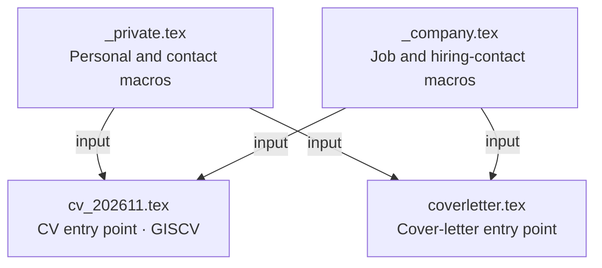

# LaTeX source overview and cleanup plan

## Overview

The four `.tex` files form two document entry points and two shared configuration inputs:

- [`cv_202611.tex`](./cv_202611.tex) is the CV document and the only source that selects a content variant. It selects `GISCV`, defines the CV layout and macros, and uses the shared personal and job details below.
- [`coverletter.tex`](./coverletter.tex) is the cover letter document. It defines its own layout and letter content, and uses the same shared personal and job details.
- [`_private.tex`](./_private.tex) defines the personal information macros (name, signature name, address, email, phone, blog URL, and LinkedIn). Both documents input it.
- [`_company.tex`](./_company.tex) defines the job company, title, and optional hiring-manager macros. Both documents input it; job/company values feed the letter text, and the job title is also used in PDF metadata.

The two document sources are otherwise independent: neither inputs the other. The shared inputs provide macro values, not standalone documents. `GISCV` is the CV's sole active content variant; obsolete `DATACV` branches are removed. The `QRCODE` block and its image reference remain available but disabled.

The main sources also rely on external assets: the local Lato font files in `fonts/`, and the cover-letter signature image `_ar_sig.png`. Both use `fontspec`; use XeLaTeX to generate the PDF files.

## Applied cleanup

- Kept `GISCV` as the CV's only active content variant and retained the disabled `QRCODE` option for possible future use.
- Removed empty conditionals and unused helpers/macros; retained the hiring-manager macros for future cover letters and kept `\CVblogurl` available in `_private.tex`.
- Updated the cover letter to use `\CVphone` from `_private.tex` and `\today` for its date.
- Retained the QR-related packages and image reference so the disabled QR option can be re-enabled; removed other obsolete commented configuration and kept alternative CV bullets as content notes.
- Did not centralize the preambles because the CV and cover letter have distinct page layouts and spacing.

## Notes

- Both documents should be built with XeLaTeX.
- The cover-letter prose is intentionally document-specific; only shared contact details such as the phone number should be sourced from `_private.tex`.
